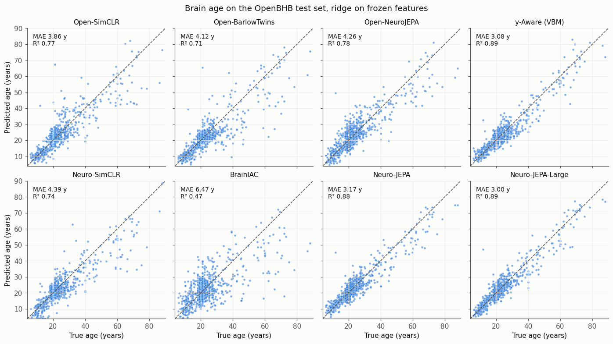

.. _pretrained_models:

=================
Pretrained Models
=================

nidl gives access to models pretrained on large neuroimaging cohorts, ready
to be used as frozen feature extractors or fine-tuned on your own data. Each
model is published on the Hugging Face Hub with a ``config.json`` that fully
describes the nidl estimator: its parameters, its encoder, the shape of its
inputs and their preprocessing. Loading a model thus gives the exact
architecture of its original implementation, the preprocessing its weights
expect, and checks on the inputs given to it.

The models currently available are published models, ported to nidl and
validated against their original code. They are faithful to their papers,
with their own pretraining data and preprocessing.

Quick start
-----------

Install the dependencies with ``pip install nidl[pretrained]``, then:

.. code-block:: python

    from torch.utils.data import DataLoader
    from nidl.estimators.ssl import SimCLR

    model = SimCLR.from_pretrained("nidl-neurospin/brainiac-vit-b")
    preprocess = model.get_preprocessing()  # parameters depending on your data

    loader = DataLoader([preprocess(volume) for volume in volumes], batch_size=4)
    features = model.transform(loader)  # frozen features
    # or fine-tune it: model.fit(train_loader)

:meth:`~nidl.estimators.base.NidlHubMixin.get_preprocessing` returns the
transform reproducing the preprocessing of the original code. Its parameters
fix what depends on your data, such as the orientation of the volumes: see
each model below for the expected input.
:meth:`~nidl.estimators.BaseEstimator.transform` rejects inputs of the wrong
shape. See :ref:`sphx_glr_auto_examples_plot_pretrained_openbhb.py`
for a complete pipeline on OpenBHB.

Available models
----------------

.. pretrained-models::
   :family: published
   :view: table

All the repositories belong to the `nidl-neurospin
<https://huggingface.co/nidl-neurospin>`_ organization. :fas:`lock` The
weights are gated: request access on the model page of their authors first.
Click on a model for its pretraining data, expected input, license and
citation.

.. pretrained-models::
   :family: published
   :view: cards

Brain age on OpenBHB
--------------------

To illustrate the use of these models, the age of the participants of
:class:`~nidl.datasets.OpenBHB` is predicted from their frozen features. 
Here, models were pretrained on different data and with different
preprocessings so this comparison is biased but offers a first idea of their
performance.

.. pretrained-models::
   :family: published
   :view: openbhb

         pretrained model.

Share your own model
--------------------

Any nidl estimator can be saved in the same format with
:meth:`~nidl.estimators.base.NidlHubMixin.save_pretrained`, or published
directly with :meth:`~nidl.estimators.base.NidlHubMixin.push_to_hub`:

.. code-block:: python

    model.fit(train_loader)
    model.push_to_hub(
        "my-org/my-model",
        preprocessing={"transform": "ZNormalization", "kwargs": {}},
        input_shape=(1, 121, 145, 121),
    )

It can then be loaded by anyone with ``from_pretrained("my-org/my-model")``.
For weights published elsewhere that cannot be redistributed, implement an
:class:`~nidl.estimators.external.ExternalWeights` converter.

Licenses and access
-------------------

The weights keep the license of their authors, given above and in the model
card of each repository: check it before using a model, in particular for
commercial or clinical use. Weights that cannot be redistributed, such as the
Neuro-JEPA ones, are downloaded from the repository of their authors, at the
commit validated with nidl, and only renamed when loading. The nidl
repositories then only hold their configuration, see
:class:`~nidl.estimators.external.ExternalWeights`.